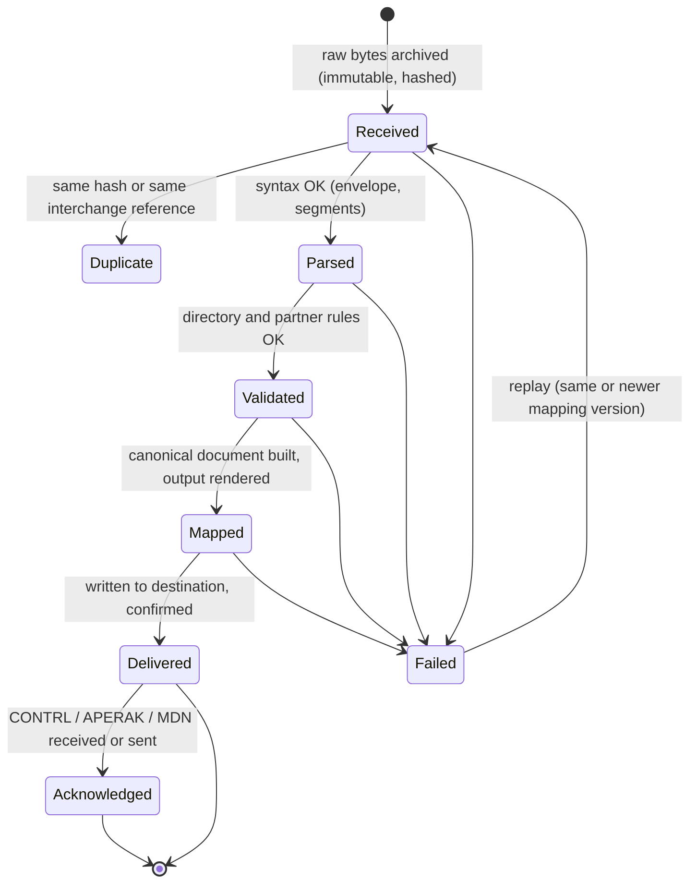
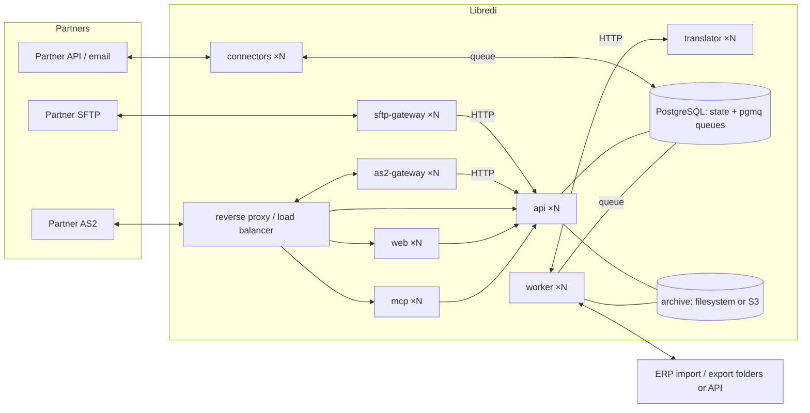
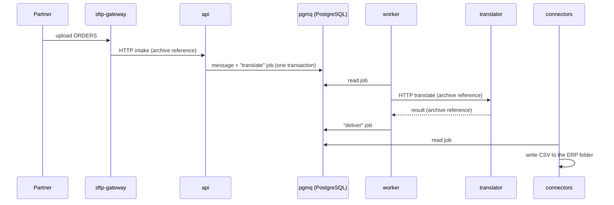

# Architecture

> Status: proposal (October 2026). Decisions are recorded in [`docs/adr`](adr/).

## Core concepts

| Concept | What it is |
| --- | --- |
| **Instance** | One Libredi installation (self-hosted) or one customer space (hosted). |
| **Environment** | `test` or `production` inside an instance. Each has its own partners' endpoints, mapping versions, numbering counters, archive and messages. Configuration is promoted from test to production, never edited live in production. |
| **Partner** | A trading partner and its identifiers (GLN, SIRET, EDIFACT/X12 interchange IDs and qualifiers). |
| **Endpoint** | How bytes travel to or from a partner or the ERP: an SFTP folder, a remote SFTP server, an AS2 station, an HTTP webhook, a mailbox, a local drop folder. |
| **Flow** | Partner + direction + message type + version, e.g. *"Distributor X, inbound ORDERS EANCOM D96A → ERP CSV"*. A flow holds the envelope rules, validation level, acknowledgement policy, mapping version and destination. |
| **Mapping** | A versioned, declarative file that turns a parsed message into a canonical document (and back), with sample files and expected outputs as tests. The format is in [`contracts/mapping`](../contracts/mapping/README.md). |
| **Canonical document** | Libredi's neutral model of an order, order response, despatch advice, invoice… Partner mappings target it; ERP exports read it. This avoids writing one mapping per partner *and* per ERP format. Defined as versioned JSON Schemas in [`contracts/canonical`](../contracts/canonical/README.md). |
| **Message** | One document travelling through Libredi, with its raw bytes, its state history, its errors and its links to related messages (order → despatch advice → invoice). |

## Message lifecycle

Every transition is recorded with a timestamp, the component that made it, and the
configuration version used. A failed message carries a plain-language explanation
(segment, position, expected vs found) and can be replayed after a fix.

## Reliability model

1. **Archive first.** A transport acknowledges receipt to the partner (SFTP rename, AS2 MDN,
   HTTP 202) only after the raw bytes are durably stored and a message record exists.
2. **Content-addressed archive.** Raw files are stored once, by SHA-256, and never modified.
   Outputs are archived the same way, so any delivered file can be traced back to its input
   and mapping version.
3. **Idempotency everywhere.** Duplicate detection on content hash and on partner +
   interchange control reference. Every job is safe to run twice; delivery uses idempotency
   keys so a retry never produces a second ERP import.
4. **Transactional outbox.** State changes and the jobs they trigger are written in the same
   database transaction; workers pick jobs up with at-least-once semantics.
5. **Retries with backoff, then a human.** Transient errors (network, partner server down)
   retry automatically; permanent errors (invalid message, mapping error) stop and alert.
6. **Replay.** Any message can be reprocessed from its raw bytes with the current or a chosen
   mapping version, in test or production.
7. **Numbering you can trust.** Interchange and message control references are allocated per
   partner and environment inside a transaction, with no gaps on retries.
8. **Alerts.** Failures, stuck messages, expected acknowledgements that never arrive, and
   certificates about to expire are reported by email or webhook.
9. **Tested mappings.** A mapping version cannot be promoted to production unless all its
   sample tests pass.
10. **Retention.** Configurable per environment, with defaults that respect legal retention of
    invoices.

## Services

The split follows technical responsibilities, so each service can be developed, tested,
scaled and replaced on its own, and written in the language that suits it best. Business
rules live in the workers and in the mappings, not spread across services.

Each service is its own Docker image with its own CI pipeline, in one monorepo. Custom
services are written in TypeScript, except `connectors` in Go; SFTP uses a proven
third-party container, and AS2 too unless our own service passes its interop tests
([ADR 4](adr/0004-language-per-service.md), [ADR 10](adr/0010-service-boundaries-and-communication.md)).

| Service | Responsibility | How it scales |
| --- | --- | --- |
| `api` | REST API: configuration, message intake from gateways, queries for the console and the MCP server, promotion test → production. | Stateless HTTP behind the load balancer; any number of replicas. |
| `worker` | Message state machine: routing, calls to the translator, delivery, numbering, retries, acknowledgements, alerts, scheduled jobs. | Competing consumers on pgmq queues (read with a visibility timeout); add replicas to drain the queues faster. Per-partner ordering, when a flow needs it, uses a partition key or an advisory lock. |
| `translator` | Parse, validate, serialize EDIFACT/X12; run mappings; render outputs. Input bytes + configuration in, result out. | Pure and stateless, CPU-bound; scale with the message volume. |
| `sftp-gateway` | SFTP/FTPS server for partners and the ERP to drop and pick up files. | Several replicas behind a TCP load balancer, sharing their user store (database) and file storage (S3 or a shared volume). See [ADR 0003](adr/0003-reuse-before-build.md). |
| `as2-gateway` | AS2 send/receive, signatures, encryption, MDN, certificates. | Our own service: stateless HTTP receivers behind the load balancer, keys and certificates in the database. If it fails the interoperability gate, OpenAS2 runs instead as an active/passive exception ([ADR 4](adr/0004-language-per-service.md)). Milestone 8. |
| `connectors` | Outbound and polling transports: push to a partner's SFTP, poll a remote server or a mailbox, call webhooks. | Each endpoint is polled under a lease (a row lock with an expiry), so N replicas share the endpoints without polling the same one twice. |
| `web` | Admin console: messages, errors, replay, partners, flows, mapping tests, promotion. | Static or server-rendered front end; any number of replicas. |
| `mcp` | MCP server for AI assistants. Talks only to the `api` with the caller's rights; writes only drafts in the test environment. | Stateless Streamable HTTP; any number of replicas. |
| `postgres` | State, configuration, job queue. | The one stateful core component: one primary, scaled vertically first, then with read replicas or a managed/HA PostgreSQL for the hosted offer. |
| archive | Raw and rendered files. | Filesystem volume on a single machine; any S3-compatible storage as soon as replicas run on several machines. |

### Communication

Decided in [ADR 10](adr/0010-service-boundaries-and-communication.md):

- **Synchronous calls use REST/JSON** with OpenAPI contracts in `contracts/openapi/`: clients
  (`web`, `mcp`, ERPs) and gateways call `api`; `worker` calls `translator`. No gRPC.
- **Asynchronous steps use pgmq queues** in PostgreSQL, through their SQL API, with job
  payloads described by JSON Schemas in `contracts/jobs/`; consumers are idempotent.
- **Files travel by reference**: requests and jobs carry SHA-256 references to the archive.
- **Each service owns its PostgreSQL schema and role**; `translator`, `web` and `mcp` have
  no database access.

### Scaling rules every service follows

1. **No local state.** Nothing that matters lives in a container's memory or filesystem:
   state goes to PostgreSQL, files go to the archive. A replica can be killed at any time.
2. **Safe concurrency.** Uniqueness (duplicate detection, numbering) is enforced by database
   constraints and transactions, never by "only one process runs this".
3. **No leader.** Scheduled work (retries, acknowledgement timeouts, certificate expiry
   checks, polling) is stored as dated jobs that any replica can claim.
4. **Graceful shutdown.** On `SIGTERM` a replica stops taking work, finishes or releases its
   current jobs, then exits; an abandoned job's lease expires and another replica retries it.
5. **Health and readiness endpoints** on every service, so the orchestrator only routes
   traffic to ready replicas.
6. **Configuration by environment variables**, the same image for test and production.

### Where it runs

- **One machine**: Docker Compose, with `docker compose up --scale worker=5 --scale translator=2`.
  Services are reached through the reverse proxy, never through fixed host ports, so
  replicas can be added freely.
- **Several machines** (hosted offer, large installations): the same images with a Helm chart
  for Kubernetes (or Docker Swarm), and autoscaling of `worker` and `translator` on queue
  depth and CPU.

Infrastructure containers (reverse proxy, backups, metrics) are add-ons in the Compose file.
