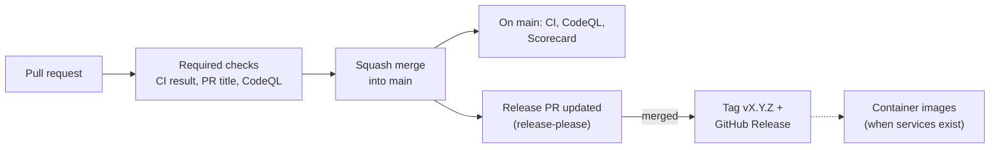

# CI/CD

How changes are checked, merged and released, and how the repository is protected.

## Pipeline

1. A contributor opens a pull request against `main`. Workflows run on every push to it.
2. The ruleset on `main` blocks the merge until the required checks pass, the branch is up to
   date with `main`, and every review conversation is resolved.
3. The pull request is squash-merged. Its Conventional Commit title becomes the commit message.
4. On `main`, release-please updates a release pull request with the next version and the
   changelog. Merging it creates the tag and the GitHub Release.

## Workflows

| Workflow                                              | Runs on                       | Purpose                                  |
| ----------------------------------------------------- | ----------------------------- | ---------------------------------------- |
| [`ci.yml`](../.github/workflows/ci.yml)               | pull requests, `main`         | Linting, workflow security, dependencies |
| [`pr-title.yml`](../.github/workflows/pr-title.yml)   | pull requests                 | Conventional Commit title                |
| [`codeql.yml`](../.github/workflows/codeql.yml)       | pull requests, `main`, weekly | CodeQL static analysis                   |
| [`scorecard.yml`](../.github/workflows/scorecard.yml) | `main`, weekly                | OpenSSF Scorecard and README badge       |
| [`release.yml`](../.github/workflows/release.yml)     | `main`                        | Release pull request, tags and releases  |
| [`links.yml`](../.github/workflows/links.yml)         | weekly                        | External links in the documentation      |

`ci.yml` runs these jobs in parallel:

- **Markdown lint**: [markdownlint-cli2](https://github.com/DavidAnson/markdownlint-cli2),
  configured in `.markdownlint-cli2.yaml`.
- **Spelling**: [typos](https://github.com/crate-ci/typos), configured in `.typos.toml`.
- **EditorConfig**: [editorconfig-checker](https://github.com/editorconfig-checker/editorconfig-checker)
  enforces `.editorconfig` (UTF-8, LF, final newline, no trailing spaces).
- **Local links**: [lychee](https://github.com/lycheeverse/lychee) checks relative links and
  anchors, configured in `lychee.toml`.
- **actionlint**: [actionlint](https://github.com/rhysd/actionlint) checks workflow syntax,
  expressions and shell scripts.
- **zizmor**: [zizmor](https://github.com/zizmorcore/zizmor) audits workflow security.
- **Dependency review**: [dependency-review-action](https://github.com/actions/dependency-review-action)
  blocks a pull request that adds a dependency with a known vulnerability of moderate
  severity or higher.
- **CI result** waits for all of them and fails if any failed or was cancelled.

### Adding a job

Add the job to `ci.yml` and list it in the `needs` of `ci-result`. Branch protection only
requires `CI result`, so the ruleset does not change. When the first service lands, expect:

- a build and test job per language, with a `paths` filter if it gets slow;
- the language in the CodeQL matrix;
- an ecosystem entry in `.github/dependabot.yml` (application packages, `docker`);
- a container job: build multi-architecture images, scan them, and on release push them to
  GitHub Container Registry with an SBOM and a signed build provenance attestation.

## Conventions enforced by the workflows

- **Actions are pinned to a full commit SHA**, with the version in a comment. Dependabot
  updates them weekly, grouped, after a 7-day cooldown. The repository refuses unpinned actions.
- **Least privilege.** Every workflow starts with `permissions: {}` and each job asks only for
  what it needs. `actions/checkout` never persists credentials.
- **No `pull_request_target` or `workflow_run`.** Workflows never run untrusted code with
  write access or secrets.
- **Superseded runs are cancelled** on pull requests, never on `main`.

## Repository protection

Ruleset **Protect main** (default branch):

- changes only through pull requests, squash merge only, conversations resolved;
- required checks: `CI result`, `PR title`, both from GitHub Actions, on an up-to-date branch;
- required CodeQL results: no new alert of high or critical severity;
- signed commits, linear history, no force push, no deletion; nobody can bypass these rules.

Ruleset **Protect release tags** (`v*`): tags cannot be moved or deleted. Releases are also
immutable once published.

Repository settings: secret scanning with push protection, Dependabot alerts and security
updates, private vulnerability reporting, read-only `GITHUB_TOKEN` by default, SHA pinning
required for actions, and approval required before running workflows from first-time
contributors' forks.

The maintainer cannot approve their own pull requests, so no approval is required for now.
When other maintainers join, require one approval from a code owner (`.github/CODEOWNERS`).

## Releases

Versions follow [Semantic Versioning](https://semver.org/). Before 1.0.0, a breaking change
bumps the minor version.

The release job authenticates as a GitHub App, because pull requests opened with the default
`GITHUB_TOKEN` do not trigger workflows: the release pull request would never get its
required checks. Until the App is configured, the job is skipped. To set it up:

1. Create a GitHub App on the owner account (Settings, Developer settings, GitHub Apps):
   no webhook, repository permissions **Contents**, **Issues** and **Pull requests** set to
   *Read and write*, installable only on this account.
2. Install it on this repository only.
3. Generate a private key.
4. In the repository settings, add the variable `RELEASE_APP_CLIENT_ID` (the App's client ID)
   and the secret `RELEASE_APP_PRIVATE_KEY` (the content of the `.pem` file).
