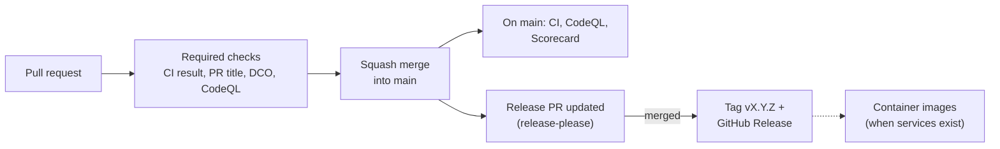

# CI/CD

How changes are checked, merged and released, and how the repository is protected.

## Pipeline

1. A contributor opens a pull request against `main`. Workflows run on every push to it.
2. The ruleset on `main` blocks the merge until the required checks pass, the branch is up to
   date with `main`, and every review conversation is resolved.
3. The pull request is squash-merged. Its Conventional Commit title becomes the commit message.
4. On `main`, release-please updates a release pull request with the next version and the
   changelog. Merging it creates the tag and the GitHub Release.

## Workflows

| Workflow                                              | Runs on                       | Purpose                                  |
| ----------------------------------------------------- | ----------------------------- | ---------------------------------------- |
| [`ci.yml`](../.github/workflows/ci.yml)               | pull requests, `main`         | Linting, services, images, Compose       |
| [`pr-title.yml`](../.github/workflows/pr-title.yml)   | pull requests                 | Conventional Commit title                |
| [`dco.yml`](../.github/workflows/dco.yml)             | pull requests                 | DCO sign-off of every commit             |
| [`codeql.yml`](../.github/workflows/codeql.yml)       | pull requests, `main`, weekly | CodeQL: workflows, TypeScript and Go     |
| [`scorecard.yml`](../.github/workflows/scorecard.yml) | `main`, weekly                | OpenSSF Scorecard and README badge       |
| [`release.yml`](../.github/workflows/release.yml)     | `main`                        | Release pull request, tags and releases  |
| [`links.yml`](../.github/workflows/links.yml)         | weekly                        | External links in the documentation      |

`ci.yml` runs these jobs in parallel:

- **Markdown lint**: [markdownlint-cli2](https://github.com/DavidAnson/markdownlint-cli2),
  configured in `.markdownlint-cli2.yaml`.
- **Spelling**: [typos](https://github.com/crate-ci/typos), configured in `.typos.toml`.
- **EditorConfig**: [editorconfig-checker](https://github.com/editorconfig-checker/editorconfig-checker)
  enforces `.editorconfig` (UTF-8, LF, final newline, no trailing spaces).
- **Local links**: [lychee](https://github.com/lycheeverse/lychee) checks relative links and
  anchors, configured in `lychee.toml`.
- **Derived data**: `scripts/check-derived-data.sh` fails when Git tracks a UN/EDIFACT directory
  file or a registry built from one ([ADR 7](adr/0007-standards-licensing.md)). Unlike the jobs that
  wait for **Changes**, it runs on every pull request, because such a file can be committed
  anywhere in the tree.
- **actionlint**: [actionlint](https://github.com/rhysd/actionlint) checks workflow syntax,
  expressions and shell scripts.
- **zizmor**: [zizmor](https://github.com/zizmorcore/zizmor) audits workflow security.
- **Dependency review**: [dependency-review-action](https://github.com/actions/dependency-review-action)
  blocks a pull request that adds a dependency with a known vulnerability of moderate
  severity or higher.
- **Changes** decides which of the jobs below have something to check, from the files of the
  pull request ([paths-filter](https://github.com/dorny/paths-filter)). The filtering is done
  in the jobs, not in the workflow's `paths`: a workflow that does not run never reports
  `CI result`, and the required check would block the merge. A manual run checks everything.
- **Workspace**: [Biome](https://biomejs.dev/) over the whole repository, `scripts/check-pins.sh`
  (the Node.js, pnpm, Go and Biome versions agree across the files that pin them), then
  typecheck and tests of the shared packages, including the checks of the files in
  `contracts/` and of the examples against the sample corpus.
- **Service (api, worker, translator, mcp)**: one job per TypeScript service, run when the
  service or a shared package changed. Typecheck, tests, build, then
  `scripts/smoke-image.sh`: build the image, run it read-only without capabilities, wait for
  its health check, check that it is not root and that `SIGTERM` stops it with exit code 0.
- **Service (connectors)**: the same for the Go service: the generated Go code must be what
  `scripts/generate-go.sh` produces from `contracts/` (the job also runs when `contracts/openapi` or
  `contracts/jobs` changes), then `gofmt`, `go vet`, `go test -race`, then the image smoke test.
- **Compose (3 workers)**: `scripts/smoke-compose.sh` starts PostgreSQL with pgmq, the five
  services and the proxy with `--scale worker=3`, and checks that everything is healthy, that
  no service publishes a host port, that the proxy routes work, that the translator cannot
  reach PostgreSQL and that a message goes through a pgmq queue.
- **CI result** waits for all of them and fails if any failed or was cancelled. A job that
  was skipped because nothing it checks changed counts as a success.

### DCO sign-off

[`dco.yml`](../.github/workflows/dco.yml) reports the check `DCO` ([ADR 9](adr/0009-developer-certificate-of-origin.md)).
It runs [`check-dco.sh`](../.github/scripts/check-dco.sh) on the commits of the pull request: every
commit except merge commits needs a `Signed-off-by:` line whose e-mail is the author's. Pull
requests opened by a bot from a branch of this repository (Dependabot, release automation) are
skipped, because a bot cannot certify the DCO; commits that a maintainer pushes onto such a branch
are not checked either. The checker fails closed: if it cannot read the commits, the check fails. It
is tested by [`test-check-dco.sh`](../.github/scripts/test-check-dco.sh), which the same job runs
first. Both scripts are taken from the base branch, not from the pull request, so a pull request
cannot weaken the check it is checked by; a change to the checker takes effect once merged. It is a
separate workflow so that `ci.yml` keeps a single required check; the ruleset requires `DCO` on its
own, pinned to GitHub Actions like the other required checks.

### Adding a job

Add the job to `ci.yml` and list it in the `needs` of `ci-result`. Branch protection only
requires `CI result`, so the ruleset does not change. For a new service, see "One image per
service" in the [development guide](development.md). Still to come:

- a container job that builds multi-architecture images, scans them, and on release pushes
  them to GitHub Container Registry with an SBOM and a signed build provenance attestation;
- per-service benchmarks.

## Conventions enforced by the workflows

- **Actions are pinned to a full commit SHA**, with the version in a comment. Dependabot
  updates them weekly, grouped, after a 7-day cooldown. The repository refuses unpinned actions.
- **Least privilege.** Every workflow starts with `permissions: {}` and each job asks only for
  what it needs. `actions/checkout` never persists credentials.
- **No `pull_request_target` or `workflow_run`.** Workflows never run untrusted code with
  write access or secrets.
- **Superseded runs are cancelled** on pull requests, never on `main`.

## Repository protection

Ruleset **Protect main** (default branch):

- changes only through pull requests, squash merge only, conversations resolved;
- required checks: `CI result`, `PR title`, `DCO`, all from GitHub Actions, on an up-to-date
  branch;
- required CodeQL results: no new alert of high or critical severity;
- signed commits, linear history, no force push, no deletion; nobody can bypass these rules.

Ruleset **Protect release tags** (`v*`): tags cannot be moved or deleted. Releases are also
immutable once published.

Repository settings: secret scanning with push protection, Dependabot alerts and security
updates, private vulnerability reporting, read-only `GITHUB_TOKEN` by default, SHA pinning
required for actions, and approval required before running workflows from first-time
contributors' forks.

The maintainer cannot approve their own pull requests, so no approval is required for now.
When other maintainers join, require one approval from a code owner (`.github/CODEOWNERS`).

## Releases

Versions follow [Semantic Versioning](https://semver.org/). Before 1.0.0, a breaking change
bumps the minor version.

The release job authenticates as a GitHub App, because pull requests opened with the default
`GITHUB_TOKEN` do not trigger workflows: the release pull request would never get its
required checks. Until the App is configured, the job is skipped. To set it up:

1. Create a GitHub App on the owner account (Settings, Developer settings, GitHub Apps):
   no webhook, repository permissions **Contents**, **Issues** and **Pull requests** set to
   *Read and write*, installable only on this account.
2. Install it on this repository only.
3. Generate a private key.
4. In the repository settings, add the variable `RELEASE_APP_CLIENT_ID` (the App's client ID)
   and the secret `RELEASE_APP_PRIVATE_KEY` (the content of the `.pem` file).
