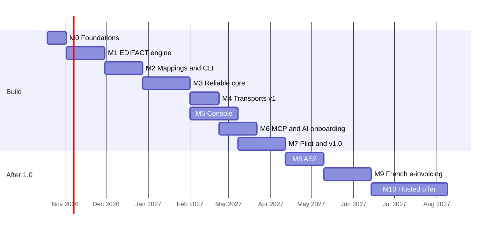

# Roadmap

> Proposal of October 2026. Each milestone below becomes a GitHub milestone; each bullet
> list becomes an epic issue with sub-issues, tracked in the public project board.
> Dates are indicative and will move with reality.

## Order and rationale

1. **Value early.** The first useful result is converting real inbound orders into the CSV
   an ERP already imports, from the command line (milestone 2). It can be compared
   immediately with the output of an existing EDI provider.
2. **Reliability before connectivity.** The message store, idempotency, retries and replay
   (milestone 3) exist before any partner is plugged in (milestone 4).
3. **See before you trust.** The console (milestone 5) comes before the production pilot.
4. **AI from day one, for ourselves.** A local MCP server over the CLI (milestone 2) lets us
   build partner mappings with an AI assistant while the product grows; the remote MCP
   server for users comes once the API exists (milestone 6).
5. **Shadow pilot before switching.** Version 1.0 is declared after running in parallel with
   an existing provider on real traffic with identical outputs (milestone 7).
6. **Licensing and regulation are design inputs**, not afterthoughts: no derived UN, GS1 or
   X12 data in the repository, and invoices only through a French *plateforme agréée*
   ([research](research/standards.md)).

## M0 — Foundations (v0.0)

Already done in #2: CI with one required `CI result` check (Markdown, spelling,
EditorConfig, links, actionlint, zizmor, dependency review), Conventional Commit PR titles,
CodeQL, OpenSSF Scorecard, release-please, Dependabot with SHA-pinned actions,
`CONTRIBUTING.md`, `SECURITY.md`, issue forms, PR template, `CODEOWNERS`, rulesets on `main`
and release tags ([CI/CD](ci-cd.md)).

Remaining:

- **Project governance**: code of conduct, support and governance files, DCO sign-off,
  labels, milestones, project board, Discussions categories and forms.
- **Architecture decisions** recorded as ADRs (this pull request).
- **Repository skeleton**: pnpm monorepo (`services/*`, `packages/*`, `docs/`), shared
  TypeScript tooling (strict mode, Vitest, fast-check), Docker Compose with PostgreSQL and
  a reverse proxy, devcontainer.
- **Container pipeline**: one multi-role image built on native amd64 and arm64 runners,
  pushed to GHCR with SBOM and provenance attestations; CI job per package with path
  filters, all aggregated in `CI result`.
- **Documentation site** (Astro Starlight) on GitHub Pages.
- **Synthetic sample corpus**: fictitious ORDERS, ORDRSP, DESADV, CONTRL interchanges in
  D96A and D01B, syntax 3 and 4, UNOA/UNOC/UNOW. Never real partner data.

## M1 — EDIFACT engine (v0.1) — *"read any EDIFACT message"*

- **Directory generator**: downloads the official UNECE directory zips at install time and
  builds a language-neutral JSON definition registry (segments, composites, elements,
  code lists, message structures). Nothing derived is committed or shipped.
- **Tokenizer and parser**: UNA, syntax 3 and 4, release character, character sets,
  lossless tree with positions; **serializer** with byte-exact round-trip.
- **Validator**: envelopes (UNB/UNZ and UNH/UNT counts and references), structure
  (segment groups, cardinalities), data elements (type, length), code lists; plain-language
  errors with segment, position, expected and found.
- **CONTRL** generation and parsing.
- **CLI** `libredi inspect <file>`: tree, JSON and validation report.
- **Quality**: golden files, property-based tests (round-trip, fuzzing), StAEDI as a test
  oracle in CI, performance benchmark.
- **Checkpoint** after two weeks: confirm the translator language on real-world-shaped
  samples (see ADR on languages).

## M2 — Mappings and CLI (v0.2) — *"convert orders to CSV, offline"*

- **Canonical documents** as JSON Schema: order, order response, despatch advice, invoice
  (versioned).
- **Mapping format**: YAML documents with per-field JSONata expressions, lookup tables as
  data, embedded fixtures; sandboxed runner (no `$eval`, time, depth and memory limits).
- **Renderers and readers**: CSV (configurable columns and separators), JSON, XML,
  fixed-width.
- **Outbound builder**: canonical document → EDIFACT with envelopes, control references and
  UNT/UNZ counts.
- **CLI** `libredi convert` and `libredi test <mapping>`.
- **Reference flows**: ORDERS → CSV, CSV → ORDRSP, CSV → DESADV.
- **Local MCP server (stdio)** wrapping the CLI: inspect, validate, run a mapping on
  fixtures, explain an error. Used by the team to build mappings with an AI assistant.

## M3 — Reliable core (v0.3) — *"never lose a message"*

- **Data model and migrations**: environments, partners, endpoints, flows, mapping
  versions, messages, transitions, numbering counters.
- **`api` service**: REST + OpenAPI, authentication, configuration, message intake.
- **`worker` service**: state machine on the PostgreSQL job queue, retries with backoff,
  dead-letter, scheduled jobs, alerts (email, webhook).
- **`translator` service**: the M1/M2 engine behind a stateless interface.
- **Archive**: content-addressed raw and rendered files on a volume or S3.
- **Guarantees**: archive-first intake, duplicate detection, transactional outbox,
  gap-free numbering, replay with a chosen mapping version.
- **Scaling and failure tests**: `--scale worker=5 --scale translator=3` under load while
  killing replicas: zero loss, zero duplicate.
- **Observability**: structured logs, OpenTelemetry traces and metrics, Prometheus endpoint.
- **Test/production environments** with promotion of configuration and UNB test indicator.

## M4 — Transports v1 (v0.4) — *"plug in real partners"*

- **`sftp-gateway`** (SFTPGo) for partners and ERP, with upload hooks to the `api`.
- **`connectors`**: push to remote SFTP, poll remote SFTP/FTP, local ERP drop folders,
  webhooks, email (IMAP/SMTP).
- **Leases** so connector replicas never poll the same endpoint twice.
- **End-to-end scenarios** in CI: partner drops ORDERS → CSV appears in the ERP folder;
  ERP drops a despatch CSV → DESADV reaches the partner, CONTRL comes back.

## M5 — Console (v0.5) — *"see and fix everything"*

- **`web` service**: login and roles, dashboard, message list and detail (raw, parsed,
  canonical, output, timeline), errors in plain language, replay, bulk actions.
- **Configuration screens**: partners, endpoints, flows, mappings.
- **Mapping editor** with live preview against samples and fixture results.
- **Promotion** test → production with a diff and passing tests required.
- **Alert settings** and audit log.

## M6 — MCP and AI onboarding (v0.6) — *"from a partner spec to a tested flow"*

- **`mcp` service** (Streamable HTTP) on top of the `api`, with the caller's rights.
- **Read tools**: messages, errors, partners, flows, statistics.
- **Action tools**: validate a sample, run a mapping, replay in test.
- **Onboarding tools**: read a partner's specification (PDF or text) and samples, draft the
  flow and mapping **in the test environment only**, with a confidence level and a spec
  reference per field; run fixtures; hand over to a human for promotion.
- **Privacy**: partner specifications stay private tenant data; bring your own model key.

## M7 — Pilot and v1.0 — *"production-ready"*

- **Security**: encrypted secrets, RBAC, audit log, dependency and image scanning,
  threat model.
- **Operations**: backup and restore, upgrade and migration policy, retention settings,
  health dashboards.
- **Documentation**: install guide, partner onboarding guide, mapping reference, API
  reference, troubleshooting.
- **Shadow pilot**: run in parallel with an existing EDI provider on real traffic (data kept
  off GitHub), compare outputs daily until identical for several weeks.
- **Release v1.0** with signed multi-arch images and an install script.

## After 1.0

- **M8 — AS2** (v1.1): spike of our own TypeScript `as2-gateway` against an interop matrix
  (OpenAS2, phase2, mendelson); then the gateway (or OpenAS2 if the gate fails),
  certificate management and expiry alerts, MDN sync/async.
- **M9 — French e-invoicing** (v1.2): Factur-X, UBL and CII generation; connector to the
  customer's *plateforme agréée* (AFNOR XP Z12-013 API); invoice enrichment; reception of
  invoices from the platform. Libredi never acts as a platform itself.
- **M10 — Hosted offer** (v2.0): multi-tenancy with row-level security, Helm chart,
  autoscaling on queue depth, metering, EU hosting, status page.
- **Later**: more messages (RECADV, ORDCHG, PRICAT, INVRPT, SLSRPT, REMADV, PARTIN),
  X12 with user-supplied schemas, AS4 (Peppol), community mapping packs.
